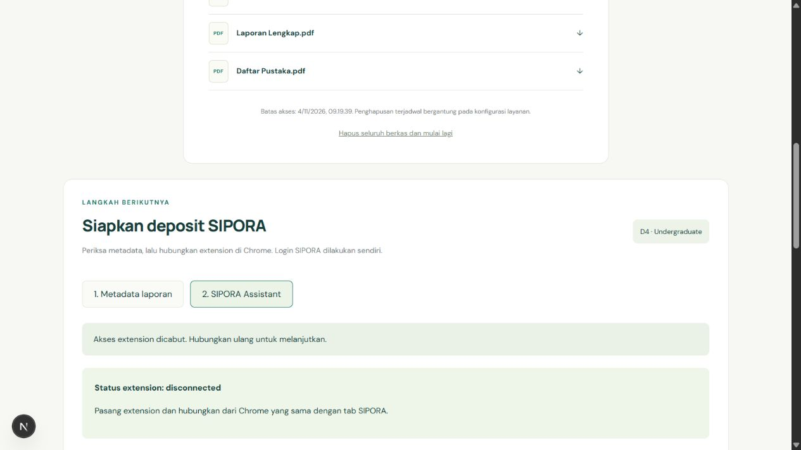
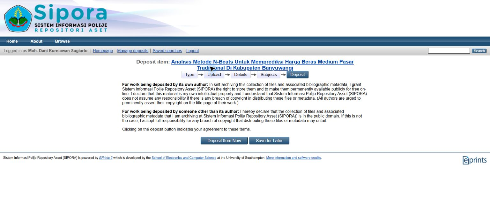
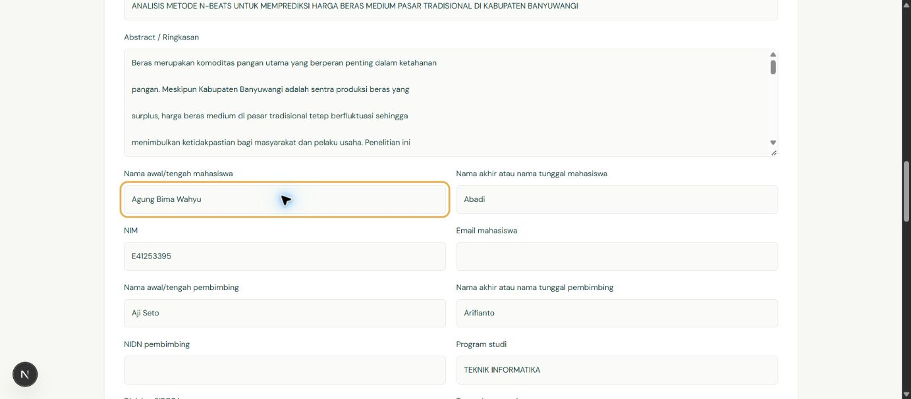
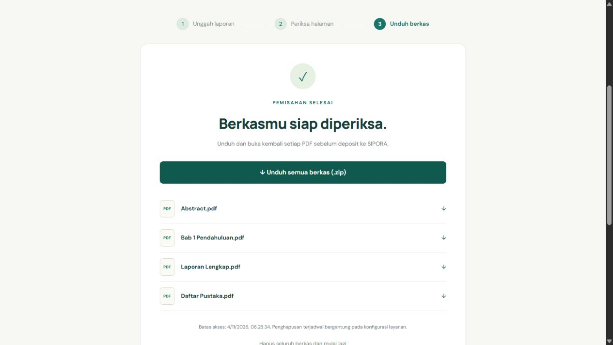
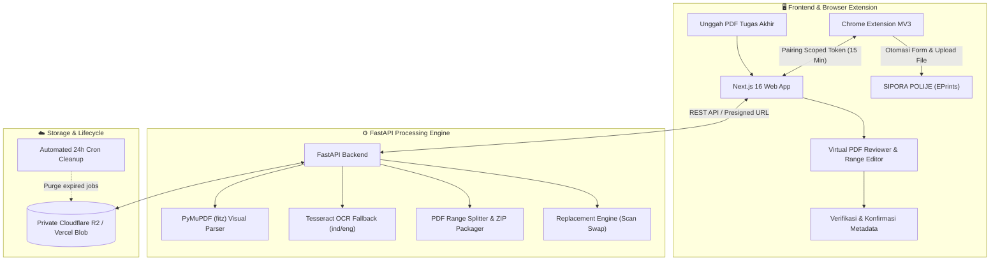

<div align="center">

# 🎓 Teman Pora (ThesisSplit v2.1)
### *Intelligent Thesis Splitter & Automated SIPORA Repository Assistant*

[](https://nextjs.org/)
[](https://react.dev/)
[](https://www.typescriptlang.org/)
[](https://fastapi.tiangolo.com/)
[](https://www.python.org/)
[](https://developer.chrome.com/docs/extensions/mv3/)
[](https://www.docker.com/)
[](LICENSE)

<p align="center">
  <b>Solusi all-in-one otomatisasi pemisahan dokumen Tugas Akhir/Skripsi POLIJE, verifikasi lembar pengesahan, dan asisten deposit repositori SIPORA (EPrints).</b>
</p>

[Fitur Utama](#-fitur-utama) •
[Demo & Tangkapan Layar](#-tangkapan-layar--antarmuka) •
[Arsitektur Sistem](#-arsitektur--alur-kerja) •
[Panduan Instalasi](#-panduan-instalasi--pengembangan-lokal) •
[Ekstensi Chrome](#-ekstensi-chrome-sipora-assistant-v213) •
[Deployment](#-deployment--cloud-storage) •
[Dokumentasi](#-dokumentasi-lengkap)

---

</div>

## 📌 Latar Belakang & Masalah

Setiap mahasiswa tingkat akhir di **Politeknik Negeri Jember (POLIJE)** diwajibkan untuk mengunggah naskah Laporan Akhir/Skripsi/Tesis (jenjang D3, D4, dan S2) ke repositori institusi **SIPORA** (*Sistem Informasi Perpustakaan Online Politeknik Negeri Jember* berbasis EPrints).

Namun, proses manual memiliki sejumlah kendala kritis:
1. **Aturan Format Ketat:** Naskah wajib dipecah menjadi **4 bagian PDF terpisah** (Bagian Awal, Abstrak, Bab 1 s.d. Selesai, dan Lampiran) dengan aturan penomoran halaman fisik vs penomoran romawi/arab yang sering membingungkan.
2. **Kesalahan Rentang Halaman:** Banyak mahasiswa keliru membaca Daftar Isi bertitik (*dotted TOC*) sebagai heading aktual bab, menyebabkan halaman terpotong atau tumpang-tindih (*overlapping*).
3. **Penggantian Halaman Scan:** Lembar pengesahan ber-tanda tangan basah harus disisipkan menggantikan halaman draft digital tanpa merusak rasio dokumen atau merusak bookmark.
4. **Formulir EPrints yang Repetitif:** Mengisi belasan field metadata, memilah rumpun keilmuan (*academic division*), dan mengunggah 4 berkas satu per satu di SIPORA memakan waktu dan rentan *human error*.

**Teman Pora** hadir sebagai ekosistem lengkap untuk menyelesaikan seluruh proses tersebut dalam hitungan menit—akurat, terverifikasi visual, aman, dan menjaga integritas akademik (*Human-in-the-Loop*).

---

## ✨ Fitur Utama

### 🧠 1. Smart Heuristic & OCR Heading Detection
- **Visual Heading Analysis:** Algoritma ekstraksi berbasis PyMuPDF yang memindai struktur baris visual halaman teratas (hingga 24 baris awal) dan secara cerdas mengabaikan daftar isi (*Table of Contents*).
- **Format Agnostik:** Mendukung variasi format `BAB 1`, `BAB I`, huruf berjarak, unicode, teks multibaris, untuk jenjang D3, D4, maupun S2.
- **Selective Tesseract OCR:** Fallback otomatis menggunakan engine OCR Tesseract (bahasa Indonesia `ind` & Inggris `eng`) apabila mendeteksi halaman hasil scan tanpa teks digital.

### 👁️ 2. Virtualized PDF Viewer & Range Editor
- **Virtualized Rendering:** Pratinjau dokumen ratusan halaman berjalan ringan dan mulus tanpa membebani memori browser.
- **Sinkronisasi Cepat:** Ketik nomor halaman fisik dan tekan `Enter` untuk langsung lompat ke pratinjau.
- **Validasi Ketat Backend:** Mencegah rentang halaman kosong, terbalik, bernilai di luar batas, tidak berurutan, atau saling bertabrakan sebelum proses *generate* diizinkan.

### 🔄 3. Ganti Halaman PDF (In-place Scan Replacement)
- Mengganti halaman draft (seperti lembar pengesahan) dengan gambar scan JPEG/PNG yang sudah ditandatangani.
- Analisis rasio aspek otomatis untuk memastikan kualitas visual halaman pengganti tidak terdistorsi.
- Menjaga kelengkapan byte dokumen asli dan struktur navigasi.

### 📦 4. Export 4 File PDF & Paket ZIP Instan
- Membagi dokumen naskah secara *byte-exact* menjadi 4 berkas standar repositori SIPORA beserta 1 naskah lengkap yang dipertahankan utuh.
- Mengunduh masing-masing berkas satuan atau langsung dalam arsip `.zip` terkompresi.

### 🤖 5. Teman Pora Chrome Extension (MV3 Assistant v2.1.3)
- **Pairing Aman:** Komunikasi satu kali klik antara web app dan ekstensi browser melalui kode pairing 2 menit (*one-time scoped grant*).
- **Auto-Fill Metadata:** Otomatis mengisi judul, abstrak, nama mahasiswa, NIM, pembimbing, NIDN, tanggal publikasi, dan kata kunci ke form SIPORA.
- **Auto-Upload 4 Berkas:** Mengunggah 4 berkas PDF hasil pecahan ke tahapan unggah SIPORA secara berurutan.
- **Academic Division Selector:** Otomatis memilih rumpun keilmuan yang telah disetujui pengguna.
- **Human-in-the-loop Safety:** Seluruh otomatisasi berhenti pada tahap tinjauan akhir (*review stage*); ekstensi **tidak pernah** menekan tombol *Deposit Item Now* demi mencegah kesalahan data permanen.

---

## 🖼️ Tangkapan Layar & Antarmuka

| Pratinjau Ekstensi & Asisten SIPORA | Alur Otomatisasi Formulir |
| :---: | :---: |
|  |  |
| *Pairing sekali pakai & status berkas* | *Eksekusi langkah otomatis pada antarmuka SIPORA* |

| Editor & Review Metadata | Pratinjau Pemisahan & Hasil Download |
| :---: | :---: |
|  |  |
| *Pemeriksaan detail naskah sebelum dikirim* | *Download 4 berkas PDF terpisah atau arsip ZIP* |

---

## 🏗️ Arsitektur & Alur Kerja



### Alur Kerja Transaksi Aman:
1. **Upload Dokumen:** File diunggah langsung ke storage privat via signed presigned URL dengan alokasi Job ID dan token akses unik.
2. **Analisis Struktur:** PyMuPDF mengekstraksi judul, identitas, dan bab utama. Jika halaman scan terdeteksi, OCR lokal dijalankan selektif.
3. **Review & Koreksi:** Pengguna meninjau nomor halaman fisik, menyesuaikan rentang, dan memastikan data pembimbing/NIM akurat.
4. **Pemisahan Berkas:** Backend memotong PDF menjadi 4 bagian spesifik tanpa merusak format font atau metadata bawaan.
5. **Ekstensi Browser Bridge:** Kode pairing acak (berlaku 2 menit) ditukarkan dengan *scoped grant* (15 menit) untuk menyalurkan metadata dan berkas ke tab SIPORA tanpa pernah mengekspos token kredensial kampus.

---

## 💻 Tech Stack

| Komponen | Teknologi | Deskripsi |
| :--- | :--- | :--- |
| **Frontend Framework** | **Next.js 16 (App Router)** | Framework React modern dengan performa tinggi dan Server Components |
| **UI Library** | **React 19 & TypeScript 5.9** | Antarmuka interaktif, typed-safe, dan bebas runtime error |
| **Styling** | **Tailwind CSS & Modular CSS** | Desain responsif, clean, dan nyaman diakses di desktop maupun laptop |
| **Backend API** | **FastAPI (Python 3.11+)** | API asinkron berkecepatan tinggi dengan validasi Pydantic v2 |
| **PDF Processing** | **PyMuPDF (fitz)** | Engine parsing dan manipulasi PDF berbasis C berkecepatan tinggi |
| **OCR Engine** | **Tesseract OCR & PyTesseract** | Pengenalan karakter optik untuk halaman naskah hasil scan |
| **Browser Extension** | **Chrome Manifest V3** | Background service worker, secure messaging, dan content script bridge |
| **Cloud Storage** | **Cloudflare R2 / Vercel Blob** | Penyimpanan objek privat berkeamanan tinggi dengan presigned URLs |
| **Container & Ops** | **Docker & Uvicorn** | Konfigurasi kontainer terpadu untuk kemudahan deployment |

---

## 🚀 Panduan Instalasi & Pengembangan Lokal

### Prasyarat
- **Node.js** v20.x atau lebih baru & **npm**
- **Python** 3.11 atau lebih baru
- **Tesseract OCR** terinstal di sistem dengan data bahasa Indonesia (`ind`) dan Inggris (`eng`):
  - *Windows:* Unduh installer [UB-Mannheim Tesseract](https://github.com/UB-Mannheim/tesseract/wiki).
  - *Ubuntu/Debian:* `sudo apt-get install tesseract-ocr tesseract-ocr-ind tesseract-ocr-eng`

---

### 1. Menjalankan Backend (FastAPI)

Buka terminal di root direktori proyek:

```powershell
# Masuk ke direktori backend
cd backend

# Buat dan aktifkan virtual environment
python -m venv .venv
.\.venv\Scripts\Activate.ps1   # Linux/macOS: source .venv/bin/activate

# Instal dependensi Python
pip install -r requirements.txt

# Salin konfigurasi environment
Copy-Item .env.example .env     # Linux/macOS: cp .env.example .env

# Jalankan server FastAPI
uvicorn app.main:app --reload --host 127.0.0.1 --port 8000
```
> Dokumentasi OpenAPI / Swagger API otomatis aktif di: [http://127.0.0.1:8000/docs](http://127.0.0.1:8000/docs)

---

### 2. Menjalankan Frontend (Next.js)

Buka terminal kedua di root direktori:

```powershell
# Masuk ke direktori frontend
cd frontend

# Instal dependensi Node.js
npm ci

# Salin konfigurasi environment
Copy-Item .env.local.example .env.local   # Linux/macOS: cp .env.local.example .env.local

# Jalankan server Next.js dev
npm run dev
```
> Buka web app di browser: [http://127.0.0.1:3000](http://127.0.0.1:3000)

*Catatan: Pastikan menggunakan alamat IP `127.0.0.1` secara konsisten antara frontend dan backend agar CORS terhubung sempurna.*

---

## 🧩 Ekstensi Chrome (SIPORA Assistant v2.1.3)

Ekstensi browser digunakan untuk menjembatani naskah yang sudah dipecah ke portal repositori kampus tanpa login kredensial ke aplikasi pihak ketiga.

### Cara Memasang:
1. Buka Google Chrome dan buka tautan `chrome://extensions/`.
2. Aktifkan toggle **Developer mode** di pojok kanan atas.
3. Klik tombol **Load unpacked**.
4. Pilih folder `extension` dari repositori proyek ini.
5. Ekstensi **Teman Pora — SIPORA Assistant** siap digunakan!

```
extension/
├── manifest.json              # Chrome Manifest V3
├── popup.html & popup.js      # Antarmuka kontrol ekstensi & status pairing
├── website-bridge.js          # Content script komunikasi aman dengan Web App
├── modules/
│   ├── sipora-detector.js     # Deteksi halaman formulir EPrints
│   ├── metadata-filler.js     # Injeksi metadata akademik
│   ├── upload-manager.js      # Penanganan upload 4 berkas PDF
│   ├── division-selector.js   # Pemilihan rumpun keilmuan otomatis
│   └── automation-v212.js     # State machine workflow otomatisasi
```

---

## 🧪 Pengujian (Testing)

Proyek ini dilengkapi dengan suite pengujian otomatis untuk memverifikasi akurasi deteksi dan kestabilan tipe:

```powershell
# 1. Jalankan unit & integration test pada Backend
cd backend
pytest -v

# 2. Jalankan type checking & build test pada Frontend
cd frontend
npm run typecheck
npm run build
```

Suite pengujian mencakup verifikasi dokumen PDF sintetis: penanganan daftar isi, batas halaman terpotong, kegagalan OCR graceful, otorisasi token akses per-job, validasi rentang tumpang tindih, dan integritas arsip ZIP.

---

## ☁️ Deployment & Cloud Storage

### Opsi A: Satu Kontainer Vercel (Next.js + FastAPI + Tesseract)
Gunakan root `Dockerfile` pada preset **Container** Vercel. Dockerfile telah mengonfigurasi Debian base dengan Next.js, Uvicorn, dan Tesseract bilingual (`ind` + `eng`).
- Atur variabel lingkungan di Vercel:
  - `PORT=8000`
  - `APP_ENV=production`
  - `STORAGE_MODE=blob` (atau `r2`)
  - `BLOB_READ_WRITE_TOKEN=...`
  - `CRON_SECRET=...`

### Opsi B: Terpisah (Vercel Frontend + Render Backend + Cloudflare R2)
- **Frontend:** Deploy folder `frontend` di Vercel dengan variabel `NEXT_PUBLIC_API_URL=https://api-temanpora.onrender.com`.
- **Backend:** Gunakan blueprint `backend/render.yaml` di Render.
- **Object Storage (Cloudflare R2):**
  - Buat bucket R2 privat dengan CORS:
    - *Allowed Origins:* domain frontend Anda
    - *Allowed Methods:* `GET, PUT, HEAD`
    - *Allowed Headers:* `Content-Type`
  - Atur Lifecycle Rule: Hapus objek pada prefix `jobs/` setelah 24 jam.

---

## 🛡️ Keamanan & Integritas Akademik

- **Zero Credential Access:** Sistem tidak pernah meminta, membaca, menyimpan, ataupun mencatat password akun SIPORA atau cookie autentikasi kampus pengguna.
- **Ephemeral Scoped Access:** Token job hanya bertahan di `sessionStorage` pengguna. Sesi kedaluwarsa secara otomatis dalam 24 jam.
- **Human-in-the-Loop Principle:** Ekstensi sengaja **tidak mengeksekusi** tombol deposit final (*Deposit Item Now*). Pengguna tetap memiliki kendali penuh untuk meninjau pratinjau akhir sebelum submit naskah ke repositori POLIJE.
- **Data Privacy:** Dokumen yang diunggah diproses dalam lingkungan privat dan dihapus secara berkala oleh background scheduler.

---

## 📚 Dokumentasi Lengkap

Pelajari lebih lanjut detail arsitektur teknis dan panduan lanjutan:
- 📖 [Arsitektur Sistem (ARCHITECTURE.md)](docs/ARCHITECTURE.md)
- 🔌 [Spesifikasi REST API (API.md)](docs/API.md)
- 🧩 [Panduan Lengkap Ekstensi (EXTENSION.md)](docs/EXTENSION.md)
- 🧪 [Metodologi Pengujian (TESTING.md)](docs/TESTING.md)
- 🚀 [Panduan Deploy Render Single Service](docs/RENDER-SINGLE-SERVICE.md)

---

## 👥 Kontribusi & Lisensi

Kontribusi dan saran perbaikan sangat dipersilakan! Silakan buat *Issue* baru atau ajukan *Pull Request*.

Proyek ini dilisensikan di bawah lisensi **MIT License** — silakan gunakan dan kembangkan secara bebas untuk kemajuan akademik.

<div align="center">
  <sub>Dibangun dengan dedikasi untuk mempermudah civitas akademika Politeknik Negeri Jember (POLIJE) 🚀</sub>
</div>
